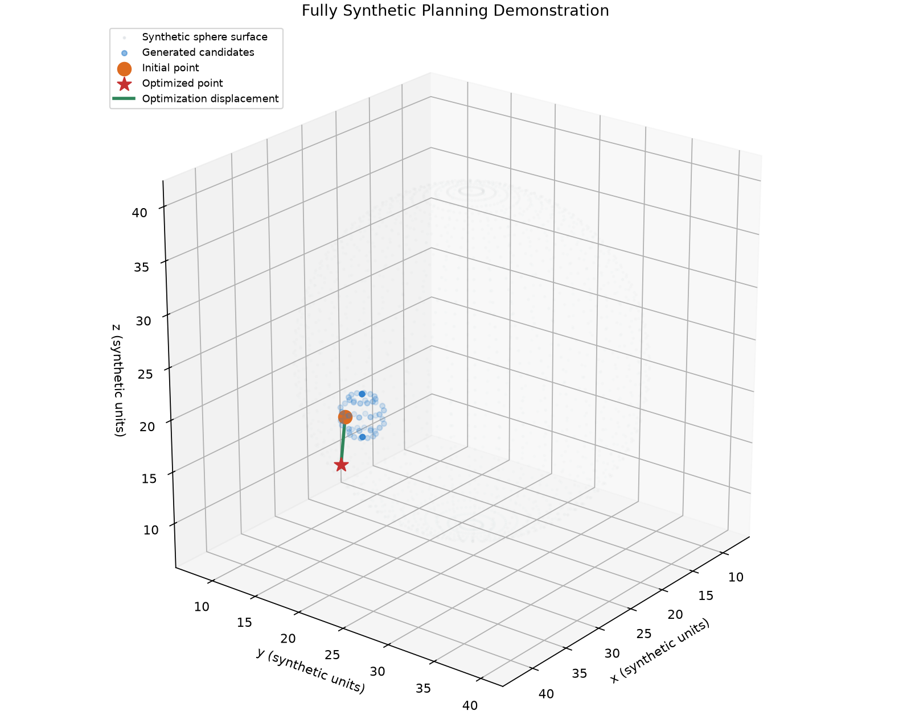
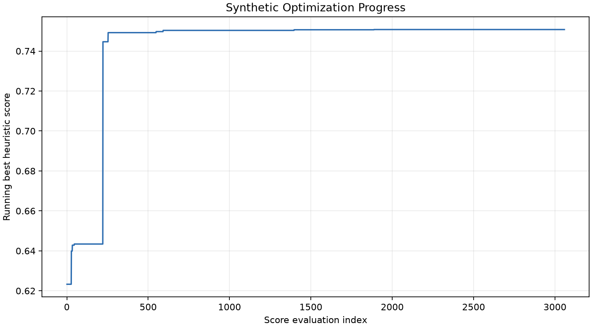

# Biomechanics-Aware Pedicle Screw Planning

[](https://github.com/xinrongli-figskat/biomechanics-pedicle-planning/actions/workflows/tests.yml)

> A CT- and geometry-based computational planning research prototype for pedicle screw placement.

This repository presents a portfolio-oriented extraction of the core computational
algorithms from a larger biomedical research prototype. It focuses on CT/HU
processing, geometric scoring, heuristic entry-point optimization, tetrahedral
mesh transition algorithms, and Abaqus C3D4 export.



## Highlights

- CT HU preprocessing and voxel/world coordinate transformation
- Geometry- and HU-aware entry-point scoring
- Heuristic local-search optimization
- Screw-trajectory sampling and segment-wise bone-density (HU/BMD) features
- Pedicle isthmus detection and constrained, risk-based screw-plan candidate search
- Automatic per-vertebra anatomical frame from a vertebra mask
- Directional (medial/lateral, cranial/caudal) interface features and whole vertebral-body BMD
- Tetrahedral transition and Abaqus export utilities
- 74 synthetic tests with GitHub Actions CI
- No real patient data or patient-derived geometry
## Overview

This repository contains a portfolio-oriented core algorithm implementation extracted and reorganized from a larger research software project. The public package focuses on inspectable computational methods and synthetic tests rather than a complete clinical application.

It does not include real clinical data, patient-derived geometry, a proprietary GUI, a bundled runtime, or third-party binaries. It also excludes unreviewed modules from the original research environment.

## Core Pipeline

```text
Synthetic CT / geometry
        ↓
HU preprocessing
        ↓
Voxel/world coordinate conversion
        ↓
Candidate generation
        ↓
Geometry / HU / cortical scoring
        ↓
Local-search optimization
        ↓
Mesh transition algorithms
        ↓
Abaqus C3D4 part / assembly export
```

The repository exposes the individual computational components above. It is not a complete end-to-end clinical workflow: image segmentation, patient-specific model preparation, screw CAD, solver execution, and clinical review interfaces are outside the public scope.

## Key Technical Components

- CT HU clipping and normalization
- Voxel/world coordinate conversion using image metadata
- PyVista/VTK geometry operations
- Geometry-aware candidate generation and scoring
- Heuristic local-search optimization
- Screw-trajectory sampling and bone-density feature extraction
- Pedicle isthmus detection, trajectory match, and candidate-plan optimization
- Tetrahedral transition templates and validation
- Shared-face triangulation
- Abaqus C3D4 part generation
- Abaqus assembly generation

## Repository Structure

```text
.
|-- .github/workflows/      # Python 3.13 synthetic-test CI
|-- docs/
|   |-- algorithm.md
|   |-- architecture.md
|   |-- images/             # Demo-generated synthetic figures
|   `-- limitations.md
|-- examples/synthetic/     # In-memory planning demonstration
|-- src/pedicle_planning/
|   |-- ai/                 # CT, geometry, scoring, and optimization
|   `-- fea/                # Tetrahedral transitions and Abaqus export
|-- tests/                  # Fully synthetic unit tests
|-- pyproject.toml
`-- README.md
```

## Testing

The current test suite contains 74 synthetic tests. They cover:

- HU preprocessing
- Coordinate conversion and round trips
- Synthetic geometry operations
- Scoring behavior
- Local-search optimization
- Screw-trajectory sampling and bone-density features
- Pedicle isthmus detection and candidate optimization on a synthetic vertebra
- Per-vertebra anatomical frame estimation
- Directional interface half-rings and vertebral-body trabecular density
- Tetrahedra and C3D4 elements
- Abaqus part and assembly writers
- Transition templates and validation
- Face triangulation
- Package imports

No real patient data is used in the test suite.

## Synthetic Demo

The demonstration uses fully synthetic volumes and geometry and contains no patient-derived data. It creates an abstract three-region HU volume in memory, constructs a generic PyVista sphere, generates local candidate points, and runs the existing scorer and local-search optimizer.

The demo calls the scorer and optimizer directly; it does not claim to demonstrate a complete image-to-plan predictor or a clinical workflow. It reads no DICOM, NIfTI, STL, VTK data, Abaqus INP, or patient JSON files.

Run it after installation:

```bash
python -m pip install -e ".[dev,demo]"
python examples/synthetic/run_planning_demo.py
```


The optimizer does not expose per-iteration history. The following plot therefore shows the running best heuristic score by score-evaluation index, recorded only by the demo wrapper without changing optimizer behavior.



## Installation

```bash
python -m venv .venv
python -m pip install -e ".[dev]"
python -m pytest -q
```

The declared Python range is intentionally conservative: Portfolio V0.3 has been tested with Python 3.13.

## Algorithm Characterization

The current entry-point planning method is a heuristic optimization algorithm based on CT intensity, geometric features, and manually defined scoring terms.

It is not a trained neural-network model. The configured scoring weights and search parameters reproduce the current research implementation; this repository does not claim that they are clinically optimal.

See [docs/algorithm.md](docs/algorithm.md) for implementation-level details and [docs/architecture.md](docs/architecture.md) for module dependencies.

## Data & Privacy

No real patient DICOM, NIfTI, STL, patient metadata, or patient-derived results are included in this repository. Tests construct arrays, image metadata, and simple geometric primitives programmatically.

## Limitations

- This is a research prototype, not a medical device.
- Planning uses a heuristic algorithm rather than a trained machine-learning model.
- Current automated test coverage uses synthetic data only.
- There has been no prospective clinical validation of this public package.
- It is not intended for clinical decision making.
- The biomechanics and FEA modules are computational research components, not validated clinical predictors.
- The public package does not perform a complete clinical planning or finite-element analysis workflow.

See [docs/limitations.md](docs/limitations.md) for a fuller scope statement.

## My Contributions

The portfolio scope highlights work on:

- Development and debugging of the entry-point scoring and optimization workflow
- CT/HU and geometry processing
- Trajectory-related geometric evaluation
- FEA preprocessing and Abaqus export workflow development
- Extraction and refactoring of the research prototype into a testable standalone package

These statements describe contributions to the presented implementation and do not assert sole authorship of the larger research software or of every underlying computational method.
